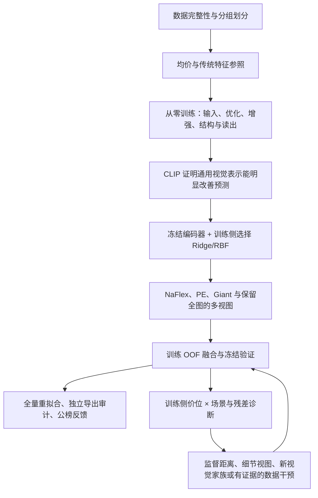

# 房屋图像价格预测：实验逻辑与设计

更新日期：2026-10-14。本文件定义研究问题、证据链、统一评价和下一步实验决策；运行结果保存在实验记录，完整生效参数保存在配置或运行登记，不在正文重复。

| 阅读目的 | 入口 |
| --- | --- |
| 理解方法为何演进、下一步为何这样安排 | 本文第 3–7 节 |
| 查全部已尝试方法及实际成绩 | [实验总览](../output/experiment_record/improvement_to_50000/实验总览.md) |
| 查最新公榜、候选 CSV、后台任务完成情况 | [最新进展与接续](../output/experiment_record/improvement_to_50000/最新进展与接续.md) |
| 新窗口接续，查环境、路径、哈希和启动任务 | [后续实验与新窗口接续](后续实验与新窗口接续.md) |
| 查历史方案及条件候选的具体参数 | [实验协议补充](实验协议补充.md)、[配置索引](../scripts/experiments/configs/README.md) |

当前已反馈最佳 Kaggle 公榜 MSE 为 **53754.87960**。最新四项视觉融合开发验证为 **56549.27383**，3000 行 CSV 已导出并独立核验，公榜待反馈。**公榜 MSE <50000 的目标尚未达成。** 下文保留历史实验的动机与有效结论，已完成队列不再作为待执行计划；旧“仅从零训练”是早期设计选择，当前课程主线采用符合限制的通用预训练视觉特征。

## 1. 任务、数据和课程范围

### 1.1 预测什么，什么信息可用

输入一张房屋图片，输出连续售价。图片提供建筑外观、庭院、材质和周围环境等线索；地段、真实面积、室内条件及交易因素往往不可见，因此视觉相似不保证价格接近。核心研究是：改善图像中价格相关信息的表示和读出，能否降低原价回归误差，并减少低价高估、高价低估？

| 数据 | 数量与格式 | 用途 |
| --- | --- | --- |
| 提供的训练图与 `train.csv` | 8000 张，`imageid,price` | 固定训练/验证、训练侧 CV、最终全量重拟合 |
| 提供的测试图与 `test.csv` | 3000 张，无售价 | 完整性检查和冻结方案后的最终推理 |
| `sample_solution.csv` | 3000 行格式示例 | 参考列名和顺序，不作为测试真值 |

`price` 原始单位是千美元；例如 549.9 表示 549900 美元。训练可将目标再除以 1000，预测须乘回；Kaggle CSV 保持千美元，不能因网页示例歧义改变单位。训练价格范围 195–2000，中位数约 639.9，分布右偏。

### 1.2 方法边界

依据本地课程 PDF 第 2 页（外层文件 `Final_Assignment/COMP90086_2026_Project.pdf`）：允许通用预训练特征，禁止在本任务/提供数据集上训练过的预训练模型、额外原始 SoCal 图片或元数据，以及预训练多模态大语言模型。这里只使用提供的图片和标签，具体视觉权重仍需登记来源与版本。

当前课程路线为通用视觉编码器 + 本组拟合的回归器/价格监督读出。Qwen3-VL-Embedding 等 MLLM 衍生模型仅作用户授权的独立本地研究，不加入课程 CSV、课程融合或 50000 目标统计；输出 embedding 而非文本不改变其来源边界。

文件名、编号、顺序、训练测试图片匹配和人工测试标签不作为预测特征；不复制匹配训练图的价格到测试图。测试图片不用于预训练、伪标签、统计拟合、校准或选参。对失败图片不自动删图、改价或认定脏数据。

## 2. 统一评价与实验完整性

### 2.1 冻结划分与训练侧拟合

保持 **6399 train / 1601 validation**，划分种子 2026。完全重复图片按组，已复核的 `1078.jpg` / `3568.jpg` 近重复也同组；`738.jpg` / `861.jpg` 图片相同但标签不同，保留原记录并同组，不平均售价。分组不跨两侧，8000 个编号恰好出现一次；不宣称已经识别所有物业身份。

组按售价中位数和稳定组标识排序，最多 10 层抽取约 20% 验证组，实际行比例允许随组大小变化。固定索引见[共享划分说明](../data_split/README.md)，机器本地划分路径由 `local_paths.json` 指定。训练 CV 使用分组三折，每折重新拟合词典、标准化器、监督距离或回归头；确定性冻结图像特征可以在来源与预处理一致时缓存复用。

已有 EDA 看过全部训练标签，验证集亦反复用于开发；多种子和 bootstrap 不能消除此选择偏差。选定基础参数的 OOF 及仅对元模型交叉拟合的分数，不标成完整嵌套、无偏或独立测试成绩。

### 2.2 指标和切片

| 指标 | 定义与用途 |
| --- | --- |
| 原价完整验证 MSE | 千美元尺度误差平方的均值，唯一主指标；全部 1601 条等权 |
| MAE | 千美元尺度绝对误差均值，解释平均偏差金额 |
| 高价尾部 MSE | 固定训练侧阈值 >1300，验证 n=159；报告样本数与总体取舍 |
| 有符号偏差及低价高估 | `mean(pred−truth)`；必要时另报正向过估均值及比例 |

价格切片统一使用 ≤300、300–700、700–1300、>1300。训练类别索引的一层标签为低价 ≤300、中价 300–1300、高价 >1300；不能将它的中价/高价名称与四档切片混用。绝对误差档为 ≤100、100–300、300–500、500–1000、>1000，单位千美元。视觉类别可重叠，未知单列；比较类别时同时报告真实价格分布，避免把价位构成误当视觉机制。

先按 imageid 对齐预测和真值，再算指标；缺失、重复或非有限输出使该次评价无效，不能删除后报分。统一恢复单位并设非负下限，不设训练最高价上限；保存未截断输出和非正数量。随机神经网络训练损失使用未截断输出。过采样、加权损失和不同目标空间仅改变训练，主验证仍是原始等权 MSE。

### 2.3 控制变量、复核和晋级

模块消融只改变登记因素，公开必要的容量、接口和计算量变化；各架构独立调优后的比较属于完整方法比较，不能把收益全部归于架构。相同最大轮数不等于相同训练步数或成本，梯度累积也不等于更大的对比 batch。

| 方法类型 | 筛选与晋级规则 |
| --- | --- |
| 从零训练/随机神经网络干预 | 2026 初筛，完整性通过且优于直接对照才追加 2027/2028；采用须三种子平均 MSE 下降且至少 2/3 同种子改善 |
| 冻结特征 Ridge/RBF/监督距离 | 小规模训练分组 CV 选参数，再评固定完整验证；报告搜索全部候选，不能把确定性方法机械重复三次当新证据 |
| 学习融合权重 | 训练 OOF 拟合非负、和为 1 的权重；元模型分组 CV 相对预先冻结基线改善至少 1%、至少 2/3 折获胜且完整验证改善后才导出 |

新增融合应明确以当前 56549.27 方案还是其他事先登记方案为基线，不能默认沿用更旧基线降低门槛。小于门槛的收益仍保存，但不事后改规则使其晋级。低价 MSE 恶化 >5% 或平均正向过估增加 >10% 作为训练干预的取舍警戒；这些是工程选择规则，不是显著性阈值。

神经网络每轮保存严格最低验证 MSE 权重，同分取较早轮；停止计数只在相对改善 >0.1% 时清零。必要时按 group_id 做 1000 次配对 bootstrap（seed 2026），报告候选减对照的 MSE 差及 95% 区间，并区分训练种子波动与固定样本不确定性。开发验证、公榜、训练拟合、扰动诊断分别展示。

## 3. 研究逻辑：证据决定下一项改动

| 问题与证据 | 研究假设 | 合适的下一项对照 | 判断边界 |
| --- | --- | --- | --- |
| 从零小头均值 122334.22，CLIP Ridge 91820.73 | 表示学习能力与数据规模限制了当前小网络 | 冻结通用 encoder，用同一划分的浅层回归器比较 | 改变预训练、容量和架构，不是单一模块因果实验 |
| 强语义编码器仍向中价收缩 | 视觉相似性未充分对齐连续价格 | 训练折内监督 PLS 距离、价格辅助对比 | 同价外观不同是难正，异价外观相近是难负；无法看到的价格因素可能诱发记忆 |
| 部分主体小、局部信息可能随缩放损失 | 保留全图同时读取细节可能有帮助 | 固定全图+局部、letterbox 或独立分辨率对照 | 不能任意裁背景；提高输入大小不能补出原图不存在的细节 |
| 相近单模型仍可能误差互补 | 不同预训练目标/几何处理提供不同预测偏好 | 训练 OOF 的增量融合 | 残差相关低不保证融合获益；权重不是对象重要性 |
| 高价训练地面外观失败多，覆盖尚不完整 | 场景×价位覆盖可能影响学习 | 先补低价标签、训练 OOF 切片，再温和重采样/权重 | 高价本身不等于困难；增强不增加独立房屋；原始等权验证不变 |
| 多模型共同失败、近邻价格差大 | 图外信息或当前模型能力可能限制结果 | 失败/成功对照、近邻与敏感性审计 | 不自动当脏数据，不由共同失败估计已证实的不可约误差下界 |

当前不能认定数据配比、泳池、曝光或注意力错位是主因。先定位误差来自哪些价位与场景，再研究对应因素；训练干预需要诊断触发，不能将多个变换同时叠加后归因于数据质量。

## 4. 已完成阶段：保留哪些决策

### 4.1 从零训练路线的有效结论

| 阶段 | 结果与决策 | 证据 |
| --- | --- | --- |
| 均价和 AlexNet 基线 | 均价 MSE 151839.69；AlexNet 三种子均值 128415.68，看图确有增益 | [02 基线](../output/experiment_record/02_baselines/实验报告.md) |
| 预处理 | 224 直接拉伸均值 127774.42、2/3 配对改善；频域低通均值 127886.38、仅 1/3 改善；组合初筛未优于单项 | [01 预处理](../output/experiment_record/01_preprocessing/实验报告.md) |
| 训练调优 | 替代优化器、调度、批量、随机失活及正则等未过采用条件；保留 AdamW 1e-4、固定学习率、有效 batch 32、dropout 0.5 | [04 训练](../output/experiment_record/04_training/实验报告.md) |
| 增强 | 水平翻转 p=0.5，三种子均值 126810.01、2/3 改善；旋转、平移、裁剪、模糊、噪声未晋级，擦除复核未通过 | [05 增强](../output/experiment_record/05_augmentation/实验报告.md) |
| 卷积结构 | 小核堆叠、多尺度、残差三项均在 2026 初筛退步，未追加种子或组合 | [06 结构](../output/experiment_record/06_architecture/实验报告.md) |
| 小回归头/编码器 | 平均汇总小头均值 122334.22，三种子优于 AlexNet；单层编码器 124389.28 未超过小头，不运行两层 | [07 读出](../output/experiment_record/07_encoder/实验报告.md) |
| 数据质量单项 | 小头四角局部预测融合三种子未通过；价位加权初筛退步；曝光关联未过门槛，未启动亮度训练 | [09 数据质量](../output/experiment_record/09_data_quality/实验报告.md) |

“未晋级”仅限相应配置、预算和评价范围，不是证明该操作普遍无效。工程缓存与运行效率改善也不等于预测准确率改善。早期神经网络是受控参照和诊断基础，当前不为完成旧流程而继续扩大从零网络。

### 4.2 传统特征参照

SIFT → 256 词 BoVW → 训练侧标准化 → Ridge。三种子均值 MSE **145336.73**，超过均价但弱于 CNN；正式全量比较已完成，不能继续写为仅小样本检查。所有训练图和验证图有描述子，零关键点不是本次主要失败原因。词典、缩放统计和回归器每折仅训练拟合；传统输入长边 320、无补边，不继承 CNN 拉伸设置。

完整参数、覆盖与成本见[03 传统报告](../output/experiment_record/03_traditional/实验报告.md)和[传统配置](../scripts/experiments/configs/01_baselines/sift_ridge.json)。空间金字塔、颜色/明暗/梯度统计、词典扩容及 SVR 是条件候选，不因为旧表中列出就当作已实施或必跑。

### 4.3 为何转向冻结视觉编码器

CLIP B/32 + Ridge 开发验证 **91820.73**、公榜 **91993.03622**，明显强于此前从零小头。后续应优先在已有效的通用视觉表示上研究回归读出、监督距离、输入几何和互补融合；另训模型的价值是公平消融或提供互补信息，不能只因架构新就默认投入训练。

| 当前方法证据 | 开发验证 MSE | 决策 |
| --- | ---: | --- |
| BLIP-base RBF；StreetCLIP RBF | 82828.31；73300.82 | 有参照意义，暂不优先重复扩容 |
| CLIP L/14-336 三视图 RBF | 69453.36 | 说明在该骨干/读出下保留全图的多视图可能有效 |
| SigLIP2 SO400M 单图；三视图 | 62189.37；61485.88 | 三视图训练 OOF 未同向改善，不宣称稳定优于单图 |
| SigLIP2 监督 PLS；价格注意力 | 61795.76；61810.30 | 价格读出候选，必须区分监督支路与整个预测器归因 |
| DINOv2-L CLS+patch mean | 80787.03 | 当前单模型较弱，不因此否定 DINOv3 |
| NaFlex SO400M，576 patches | 63086.48 | 单模型排名不高，融合互补性有效 |
| PE-Core-L 单图；三视图 | 61825.75；59213.17 | 优先沿有效家族研究几何/读出 |
| SigLIP2 Giant-opt/384 | 59002.39 | 已完成实际 GPU 提取，能提供增量信息 |
| PE 三视图 PLS 乘积核 | 59483.31 | OOF 改善但完整验证略退步，保留互补对照，不直接替换普通核 |

完整搜索、失效和分组结果见[实验总览](../output/experiment_record/improvement_to_50000/实验总览.md)。微调 CLIP、价位加权、非线性融合和有序价格读出等也已尝试，未据此替代当前强融合；不在正文重新列出全部候选数值。对比 curriculum 的已选检查点在 hard 阶段之前，与 easy 分支相同，不能声称困难课程已有效。

## 5. 当前方案及剩余误差

### 5.1 最佳公榜与最新候选分开记录

| 全量导出运行 ID | 方案 | 参考开发验证 MSE | 用户反馈公榜 MSE |
| --- | --- | ---: | ---: |
| `20261013T135119Z_807127d3` | CLIP/BLIP/StreetCLIP 等视觉融合 | 69938.82 | 67793.02467 |
| `20261013T154808Z_e17d33cf` | SigLIP2 主导融合 | 61652.21 | 57971.95056 |
| `20261014T035153Z_01a3ae7f` | NaFlex+PE+SigLIP2 监督距离核主导 | 57982.73 | **53754.87960** |
| `20261014T044646Z_7d1af3eb` | PE 三视图+NaFlex+Giant+PE 单图 | **56549.27** | **待反馈** |

反馈与每个 CSV 的 SHA256 绑定。最新候选元模型 CV 为 58211.51，相对登记旧基线 58968.87 改善 1.284%，3/3 折改善，通过原定 1% 门槛。Giant 单独增量融合虽然验证 57018.90，但元模型 CV 只改善 0.839%，未单独导出；没有事后改门槛。新联合方案全量 8000 标签重拟合，并经精确零项等价移除、验证回放和全部测试输出独立审计。

最新非零权重：PE 三视图 45.17%、NaFlex 27.45%、Giant 20.45%、PE 单图 6.94%。是预测系数，不是视觉对象重要性。提交文件、哈希和审计见[最新导出报告](../output/experiment_record/08_final/visual_kernel_ensemble/20261014T044646Z_7d1af3eb/实验报告.md)。

### 5.2 剩余问题仍在两端

| 固定验证价格区间 | n | 新融合 MSE | 平均偏差（预测−真实，千美元） |
| --- | ---: | ---: | ---: |
| ≤300 | 169 | 24606.82 | +115.07 |
| 300–700 | 775 | 24273.79 | +77.12 |
| 700–1300 | 498 | 49416.10 | −9.97 |
| >1300 | 159 | 270159.95 | −423.79 |

相对旧融合总体下降 1433.45，条件性 bootstrap 区间 [-2183.32, -702.21]；增益主要来自中价区间，最高价偏差只从 −425.09 改善到 −423.79，尚未解决尾部低估。[配对比较](../output/experiment_record/15_fixed_ensembles/pe_multiview_giant_oof_fusion/20261014T044041Z_ee76e803/paired_validation_comparison.json)不修正反复开发选择。

### 5.3 场景证据用于定位，不直接改标签

训练侧 636 张高价图已全量审阅：地面外观 359、航拍 115、可见泳池 94；泳池等特征与主场景可重叠。旧 CLIP B/32 OOF 中地面外观误差 >500 比例 72.7%，航拍 47.8%，泳池 48.9%，不支持“泳池是最主要困难类别”。宽阔建筑体量仅 6 张确认、630 未知，明显植被遮挡阳性仅 11 张，不能据小样本推广。

低价训练 680 张目前只抽样 100，中价 5083 张只抽样 200，其余特征未知；需要补齐低价和按需复核，不能将已标频率当全量覆盖。CLIP L/14、SigLIP2 与其 PLS 核已有训练 OOF 场景审计；当前 PE/Giant 融合仍需相同定义的更新。[标注与分档报告](../output/experiment_record/09_data_quality/training_categories/high_price/高价标注与误差分布.md)、[后续 OOF 聚合](../output/experiment_record/09_data_quality/siglip2_training_oof_scene_audit/summary.json)。

## 6. 下一轮：按信息增量与执行成本排序

### 6.1 P0：闭环最新提交，更新训练侧诊断

先登记 `044646` 的用户公榜反馈，保留旧最佳提交。同步复用现有基础模型 OOF 和融合 `meta_crossfit_predictions.csv`，统计统一价位×场景误差、成功/失败及高低价视觉近邻。说明融合预测是否交叉拟合，保留基础选参偏差。

补标低价图时随机混排，不显示具体售价或模型预测；高价标签可固定抽 40 张复核，区分随机与失败案例。主体占比先用粗粒度审计，不假装已有全量检测框。人工标签只供诊断/可选训练采样，推理不输入真实价位或人工类别。验证视觉切片需另行登记且不进入训练采样，不能将训练注释直接外推为验证标签。

### 6.2 P1：PE 价格监督距离的互补性

PE 三视图 PLS 实验已完成，无需重跑提取或 13 设置。所选 4 分量、PLS gamma=0.1、alpha=1、图像 gamma=1；训练 OOF 60326.76→59515.43，完整验证 59213.17→59483.31，尾部 276297.91→266009.73。先比较训练 OOF 残差及两端偏差，再决定是否登记一次增量融合，不以尾部改善单独替换普通核。[结果与协议](../output/experiment_record/19_image_embedding_reference/pe_core_multiview_price_metric_kernel/20261014T051116Z_13d3ea16/实验报告.md)。

工程上 PLS 拟合已支持 PE，但融合/导出源适配器仍限制 SigLIP；需保留 PLS 乘积核、折内标准化和文件/代码哈希绑定，扩展后数值回放，再开新融合注册。不能冒充普通图像 RBF，也不能在活动推理中修改依赖。

### 6.3 P2：PE-Core-G 的可运行性与准确率分开验证

PE-Core-G14-448 权重已下载且下载器核验发布者 LFS SHA；尚未 GPU 预检、提取或房价拟合。约 1.882B 参数、1280 维输出，FP16 参数约 3.506 GiB，不保证 RTX 2060 6GB 可运行。[准备状态](../output/experiment_record/19_image_embedding_reference/pe_core_giant_planned_experiment.json)。

先核对全部 checkpoint key/shape，研究 Meta 构建与逐张量 FP16 加载，避免约 16GB RAM 下建立完整 FP32 CPU 模型；`rope.pos_embed` 必须按原公式生成，不能填零。保留官方 learned projection 与处理器。batch 1 在固定训练图测 finite/unit/repeat、峰值显存和速度，通过后才登记完整 8000 图冻结提取、训练 CV 回归与增量融合。资源失败不等于价格预测失败。

### 6.4 P3：新视觉目标和读出候选

以下均为待检验方向，通用检索/分类成绩不能直接证明房价 MSE 更低。

| 候选 | 任务假设与第一项实验 | 决策约束与来源 |
| --- | --- | --- |
| NaFlex 更大 patch 预算 | 保留宽高比和细节，独立增加 token 预算 | 先资源预检，与已完成 576 patches 直接对照；[官方接口](https://huggingface.co/docs/transformers/model_doc/siglip2) |
| PE-L 中间层 / PE-Spatial | 空间与局部特征可能补充最终语义输出；预定一个层/池化方式 | 全图参照不变，不同时更换骨干与读出；[官方实现](https://github.com/facebookresearch/perception_models/blob/main/apps/pe/README.md) |
| DINOv3 B/16 或 L/16 通用 web 权重 | 自监督密集视觉表示，先 CLS / patch mean / 拼接 | 三种读出事前固定；DINOv2 较弱不直接否定它；[官方来源](https://github.com/facebookresearch/dinov3) |
| AIMv2-Large 视觉编码器 | 不同预训练目标可能提供互补性 | 仅发布的通用视觉骨干，冻结 Ridge/RBF；[模型来源](https://huggingface.co/apple/aimv2-large-patch14-224) |
| EVA-CLIP / EVA02-CLIP L 级 | CLIP 家族配方补充 | 在前面候选后按预算决定，不默认巨型模型；[官方来源](https://github.com/baaivision/EVA/tree/master/EVA-CLIP) |

一个实验只新增一个编码器、输入方案或读出因素。单模型稍弱仍可检验 OOF 融合互补性，但不根据验证或公榜遍历很多层/窗口/权重挑最低。模型 revision、预处理、精度、特征维度和代码版本共同定义缓存身份。

### 6.5 P4：诊断触发的数据干预与对比训练

| 分支 | 启动条件 | 唯一改动与对照 |
| --- | --- | --- |
| 主体/细节 | 同价位、同场景审计支持小主体/缩放丢失线索 | 保留全图的固定局部特征或预测融合；必要时参数量匹配对照，不逐图选有利裁剪 |
| 曝光 | 原关联门槛至少 30 例/组、MSE 比 >1.2，且新的训练侧留组诊断支持 | 温和亮度 p=0.5、倍率 0.9–1.1；不同时锐化、去噪或变对比度 |
| 场景×价位覆盖 | 可靠补标/训练留组诊断确认不足，未知独立处理 | 温和重采样或加权损失分别研究，不同时改变采样与损失 |
| 价格对比 | 冻结强特征浅层读出仍不能保留可见价格差异 | λ=0、简单对比、难负、难正逐项消融；先头部，再据证据考虑局部解冻 |
| 信息不足候选 | 多模型 OOF 共同失败且视觉近邻价格分散 | 固定失败与成功对照分析，不删图、不改价 |

同价而外观不同是难正，异价而外观相似是难负。价格接近并不要求整幅图像所有信息都一致，辅助约束须温和，不默认所有 batch 其他图片都是负样本。历史 C0–C3 的完整参数保存在[协议补充](实验协议补充.md)，属于未整体执行的从零路线设计；不能将其当作已有冻结 CLIP/SigLIP 头实验的确切设置或当前自动队列。

### 6.6 独立本地 Qwen3-VL-Embedding

[Qwen3-VL-Embedding-2B](https://huggingface.co/Qwen/Qwen3-VL-Embedding-2B)计划为固定图片+instruction → 冻结归一化向量 → 训练标签拟合 Ridge/RBF；尚未启动。它使用语言模型路径，课程路线排除。已有 Qwen3.5-2B 零样本直接估价约 109500.16，不能替代 embedding 的监督回归对照。

先 12 张训练图片做 batch 1、固定 token 上限的资源/数值预检，不据这 12 张价格表现调 prompt。官方默认 instruction 与预先登记的建筑外观 instruction 分开比较，不输入真实价格、价位、人工类别或地址。2B FP16 在 6GB 上也需实测；输出 embedding 量化不等于 4-bit 骨干权重量化。独立环境、缓存和结果另存，8B 非本机首轮方向。

## 7. 从实验登记到最终输出

每项新实验登记“证据 → 假设 → 直接对照 → 唯一变化 → 生效参数/搜索范围 → 评价与晋级 → 成本 → 结果与下一步”。先少量训练图检查正确性和资源，再开始完整实验；预检是工程验收，不是预测效果证据。相同配置与数据已验证的运行可复用，不重跑来制造额外证据。

| 产物 | 必须保存 |
| --- | --- |
| 来源和完整性 | 数据/划分/标签/配对/模型 revision、源码及预处理指纹，环境、精度、设备 |
| 拟合与预测 | 全部 CV 候选、折内学习对象、回归头/权重、逐图预测、停止与失败原因 |
| 比较与解释 | 完整 MSE/MAE/尾部、切片 n/偏差、成本、采用/未采用结论 |
| 归因审计 | 固定样本、层与显示范围；价格输出的梯度/遮挡或适用的 Grad-CAM |

注意力和敏感图只说明响应，不证明泳池、面积或背景的因果贡献；辅助对比投影热图不替代价格输出解释。近邻、PCA 和二维嵌入只作探索，PCA 训练拟合。增强、扰动、重复视图不增加置信区间的独立房屋数量。真正新视角合成需要深度/位姿等信息，本轮不借二维变换声称恢复 3D 面积。

公开聚合和协议写到 `output/experiment_record/`；权重、原图、逐图私有证据和缓存在 `.local/`。每次新 run，不覆盖历史失败或注册哈希。当前脚本、运行资源和准确路径由[接续文档](后续实验与新窗口接续.md)维护，主设计不重复动态 PID 或长 SHA。

方案冻结后在全部 8000 标签图重拟合所有训练统计和回归头，保持 CV 选定参数及融合权重；神经网络全量训练时长从最终开发方案事前确定，例如三种子最佳轮次中位数。测试时固定处理器、关闭随机增强/失活，仅推理，不再拟合任何统计量。

最终 CSV 按 test.csv 顺序输出 **3000 行 `imageid,price`**、无索引、唯一且覆盖完整、有限非负。保留 CSV SHA、验证回放、缓存/原图校验与独立价格回放，公榜反馈绑定具体 CSV。全量训练误差不是验证成绩，公榜不是最终私榜；预测区间若未校准，不能称为置信区间。

## 8. 课程交付与报告证据

本地项目 PDF 记载两人小组，计划截止 2026-10-04，最终项目截止 **2026-10-25 23:59**；具体时区、更新、注册与 Kaggle 限额以 Canvas/竞赛最新公告为准，不由本地副本推算。未确认的成员安排或显卡小时预算不写成已承诺排期。

| 交付 | 要点 |
| --- | --- |
| 项目计划 | 使用课程模板，任务与报告分工、日期、沟通、数据备份、签名；旧模板状态不代表最新组内提交状态 |
| 代码与预测 | 环境、数据放置、训练/推理、权重获取/加载和可复现文件；包含最终预测，不打包课程图片、venv 或整份 EDA |
| 报告 | IEEE 会议短论文 PDF，A4 正文 ≤4 页，参考文献可到第 5 页；方法与实验自洽，关键消融、失败与限制有证据 |
| Kaggle | 按课程要求注册和组队，队名使用组员学号，核对最终选定提交；不得绕过限额或跨队代交/分享受限数据 |

本地评分分配：计划 2、报告写作 5、方法论证 10、实验评价 10、Kaggle 3。50000 是本项目改进目标，不是课程给出的满分阈值；公开分数不能替代正确方法、复现和有证据的错误分析。

报告逻辑沿用本文：图像回归困难 → 固定分组评价 → 基线和表示路线 → 关键多视图/读出/融合消融 → 两端与场景错误 → 信息与课程限制。详细课件/结构参数链接见[协议补充](实验协议补充.md)，引用理论不能替代本任务实验证据。最终交付前从预期入口实际验证环境、训练/加载和推理说明。
