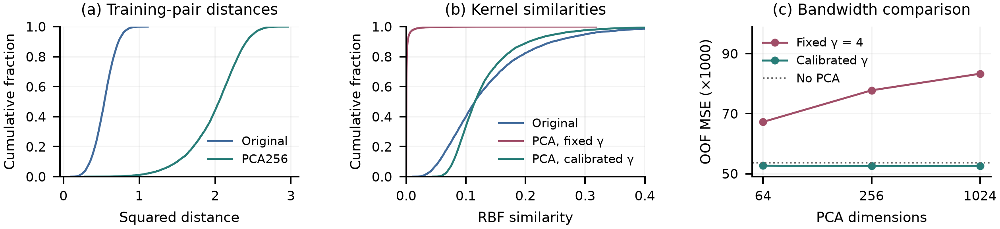

# 基于冻结视觉特征与核回归融合的房价预测

## 引言

房屋售价预测需要综合房屋自身属性与外部环境，包括面积、房屋状况、地理位置和市场条件。外观照片提供了其中一部分信息：计算机视觉可以描述建筑形态、表面外观、庭院绿化及周边场景。然而，单张照片的覆盖范围有限，也无法直接给出建筑面积、精确地址或交易条件。基于这一背景，本研究探讨如何更有效地提取房屋图像中的视觉特征，从而更准确地预测房屋售价。

这一问题可以从不同层次的视觉表示入手。传统手工局部描述子概括梯度与纹理模式，而 AlexNet [1] 等卷积网络能够从训练图像中学习层次化特征。随着大规模预训练的发展，视觉表示可以在不同任务之间复用。CLIP [2]、SigLIP2 [3] 和 Perception Encoder [4] 提供了这类表示，使冻结编码器、单独学习任务回归器成为可行路线。

据此，本研究分三个阶段展开，各阶段检验前序实验暴露出的限制。首先，使用 SIFT 与视觉词袋检验局部外观是否包含价格信号；随后，引入 AlexNet 回归模型，通过训练调优、数据增强和架构对照逐步改进。尽管这些调整改善了基线，剩余误差仍然较大，因此第三阶段转向冻结预训练特征，进一步研究图像覆盖、特征变换与回归方式如何影响价格预测，并组合互补分支。

最终三编码器融合的验证 MSE 为 52,201.21，MAE 为 159.58；全量重拟合后的 Kaggle 公榜 MSE 为 47,291.35。后续分析将这些收益与视觉表示及核回归设计联系起来，同时考察持续存在的高价低估和不同价位之间不均匀的改善。

## 方法

### 数据、指标与评价方法

数据集包含来自南加州房产挂牌信息的 8,000 张有标签训练图像和 3,000 张无标签测试图像，价格单位为千美元。模型使用课程提供的图像和价格拟合，通用预训练图像编码器提供可迁移的视觉特征。

我们使用种子 2026 固定划分 6,399 张训练图像和 1,601 张验证图像，将已识别的重复或关联图像保留在同一组中。对于 $N$ 张评价图像，记真实价格为 $y_i$，预测价格为 $\hat y_i$，则

$$

\mathrm{MSE}=\frac{1}{N}\sum_{i=1}^{N}(\hat y_i-y_i)^2,\qquad
\mathrm{MAE}=\frac{1}{N}\sum_{i=1}^{N}|\hat y_i-y_i|.

$$

主要指标 MSE 对较大误差更敏感，MAE 衡量平均绝对误差。两者单位分别为（千美元）$^2$ 和千美元；有符号残差 $\hat y_i-y_i$ 用于描述预测偏差。

随机训练模型先使用种子 2026 初筛，有希望的候选再以种子 2027 和 2028 复核。当三种子的平均 MSE 下降，且至少两次同种子配对比较改善时，保留相应改动，并报告三种子均值与配对结果。冻结特征回归器通过训练集上的分组三折折外预测（OOF）选择。视觉词典、标准化器、PCA 和监督变换均在各折训练部分拟合。

### 基线与 CNN 受控实验

我们首先以训练集均价建立不使用图像的参照。为检验局部外观能否提供额外信息，提取灰度 SIFT 描述子 [5, 6]，构建包含 256 个视觉词的词典 [7]。直方图依次进行 L1 归一化、平方根变换、L2 归一化及标准化，再拟合岭回归 [8]（$\alpha=10$）。虽然这种表示能够描述局部梯度结构，但直方图汇总会丢失空间排列，因此进一步引入直接从图像学习特征组合的 CNN。

AlexNet 风格回归网络 [1]由五个卷积层和 9216--4096--4096--1 的预测头组成，从随机初始化开始训练。经过预处理比较，选定直接缩放至 $224\times224$，使用均值和标准差均为 0.5 的 RGB 归一化，不进行滤波。保留配置为 AdamW [9]，学习率与权重衰减均为 $10^{-4}$，dropout [10, 11] 为 0.5。每个微批次包含 4 张图像，累积 8 次梯度，得到有效批量 32。训练时将价格除以 1,000，预测时恢复至数据集尺度。每次最多训练 60 轮，至少训练 40 轮，早停耐心为 15 轮，有效改善阈值为 0.1%；保存验证 MSE 严格最低的检查点。

为检验优化敏感性，代表性初筛使用学习率 $3\times10^{-5}$、$10^{-4}$、$3\times10^{-4}$ 和 $10^{-3}$，有效批量 16/32/64，以及 dropout 0/0.2/0.5。实验比较包含 Adam [12] 的优化器、不重启的余弦衰减 [13]、有效批量、正则化和初始化 [14, 15]，再研究数据增强。几何变换与退化变换分别测试，其中水平翻转的概率为 0.5。架构实验借鉴小核堆叠 [16]，用两个 $3\times3$ 卷积替换第二个 $5\times5$ 卷积，检验局部特征组合；通过 Inception 风格的多尺度模块 [17] 比较不同感受野；通过投影残差连接 [18] 检验特征复用。为检验大型预测头在有限监督下是否过拟合，我们将 $6\times6$ 卷积特征投影到 128 维，加入位置信息与归一化，对 36 个 token 求均值后进行线性回归。随后测试单层 Transformer [19]，维度为 128，注意力头数为 4，前馈层维度为 512。每项改动均与对应对照比较。

另以种子 2026 进行独立的光度增强初筛：亮度或对比度分别在每张训练图像上使用从 $[0.9,1.1]$ 均匀抽取的倍率，在缩放与归一化前应用。两者均与新训练的无增强 AlexNet 比较，保持初始化、划分和训练设置一致。

### 冻结表示、多视图与回归

为进一步改进从零训练模型，我们将视觉表示与价格回归分开研究。冻结 CLIP ViT-B/32 特征经标准化后结合岭回归，建立迁移学习参照；最终分支使用 SigLIP2 So400m NaFlex、PE-Core-L/14 和 PE-Core-G/14。NaFlex 使用 576 个 patch 保留原始宽高比，输出 1,152 维特征。考虑到单次裁剪可能移除有用环境，PE-L 组合三个 1,024 维视图：官方输入、336 像素灰色补边整图，以及保留原图宽高各 60% 的中央裁剪。PE-G 组合官方 448 像素视图与灰色补边整图。各视图特征先独立单位化，拼接后再次单位化，得到 3,072 维 PE-L 特征和 2,560 维 PE-G 特征。

我们使用 RBF 核岭回归 [20] 描述冻结特征空间中的非线性关系，并通过正则化控制拟合系数。单位特征的平方距离等于一减余弦相似度的两倍，因此 $\gamma$ 控制局部视觉近邻如何影响价格。对于 $x$：

$$

 K_{ij}=\exp(-\gamma\|x_i-x_j\|^2),\quad
 c=(K+\alpha I)^{-1}(y-\bar y\mathbf{1}).

$$

预测为 $\bar y+k(x)^Tc$，并将负预测截断为零。普通核回归在训练折中搜索 $\gamma\in\{1,4,16\}$ 和 $\alpha\in\{0.01,0.1,1,10\}$。NaFlex 选定 $\gamma=1$、$\alpha=0.1$。

然而，通用视觉相似度也可能强调与价格无关的变化。因此，PE-L 通过折内拟合的偏最小二乘（PLS） [21, 22] 学习价格相关方向。每折拟合 16 个分量，选定预测头使用前四个标准化得分 $s$，构造乘积核：

$$

 k(x,x')=\exp\left(-\|x-x'\|^2-0.1\frac{\|s-s'\|^2}{4}\right),

$$

其中 $\alpha=1$。PLS 得分在保持图像编码器冻结的同时，将价格相关方向引入相似度计算。

与监督式 PLS 不同，PCA [23] 不使用价格，而是沿主要变化方向压缩特征。对于 PE-G，我们比较 64、256 和 1,024 维，白化幂取 0 和 0.5，变换后再次单位化。由于这会改变特征距离，我们同时对原有 $\gamma=4$ 进行校准：

$$

 \gamma'=4\frac{\operatorname{median}\|x_i-x_j\|^2}
 {\operatorname{median}\|z_i-z_j\|^2}.

$$

其中 $z$ 为变换后的单位向量，中位数由各折训练部分固定抽取的 8,192 对不同图像计算。最终选定不白化的 PCA256，$\alpha=1$。

### 融合与最终重拟合

借鉴堆叠回归 [24]，各分支以非负权重融合，并增加权重总和为 1 的约束。权重由训练 OOF 预测拟合，并通过元模型交叉拟合评价：每折使用其余折拟合的权重预测。当新增分支使 meta-CV MSE 至少改善 1%，至少两折改善，且验证 MSE 同时下降时，保留该分支。

最终权重分别为 NaFlex 0.108065、PE-L PLS 0.080806、PE-G PCA 0.811129。生成 Kaggle 提交时，保持选定超参数和融合权重，在全部 8,000 张有标签图像上重新拟合变换与回归头，并重新计算训练集的 PCA 和带宽统计，再预测 3,000 张测试图像的价格。

## 结果

| 方法 | 验证 MSE | 验证 MAE |
|---|---:|---:|
| 训练均价 | 151,840 | 294.47 |
| SIFT–BoVW–Ridge | 145,337 | 288.66 |
| AlexNet | 127,774 | 264.52 |
| AlexNet + 翻转 | 126,810 | 268.02 |
| 翻转 AlexNet + 均值头 | 122,334 | 261.48 |
| CLIP B/32 + 岭回归 | 91,821 | 223.27 |
| NaFlex + RBF | 63,086 | 181.28 |
| PE-L（三视图）+ RBF | 59,213 | 172.90 |
| PE-L（三视图）+ PLS/RBF | 59,483 | 171.73 |
| PE-G（双视图）+ PCA/RBF | 52,806 | 160.67 |
| 三编码器融合 | 52,201 | 159.58 |

表 1. 验证集 n = 1,601；MSE 单位为（千美元）²，MAE 单位为千美元。SIFT 与三个 AlexNet 结果为三种子均值，冻结特征行使用选定拟合。

### 均价、SIFT 与 AlexNet 基线比较

训练均价预测的 MSE 为 151,839.69，SIFT--BoVW--Ridge 将其降至 $145,336.73\pm1,091.58$，表明局部外观包含有限的价格信号。考虑到词袋汇总丢失空间排列，我们进一步检验能够学习特征组合的 CNN。补边 AlexNet 的平均 MSE 为 128,415.68，直接缩放后降至 127,774.42（表 1）。这促使我们继续考察训练方式和模型容量能否解释剩余误差。

### CNN 训练、数据增强与架构消融

| 设置 | MSE | MAE |
|---|---:|---:|
| **A. 几何与退化增强初筛** | | |
| 无增强 | 128,268.67 | 259.99 |
| 水平翻转 | 126,601.97 | 263.16 |
| 旋转 | 129,526.18 | 260.29 |
| 平移 | 129,162.73 | 262.97 |
| 随机裁剪 | 130,222.98 | 272.60 |
| 高斯模糊 | 129,941.36 | 261.20 |
| 高斯噪声 | 131,174.53 | 271.48 |
| 随机擦除 | 128,114.40 | 268.07 |
| **B. 光度增强初筛** | | |
| 新训练对照 | 131,389.94 | 282.64 |
| 亮度 | 131,433.91 | 274.50 |
| 对比度 | 128,860.53 | 269.01 |

种子 2026，验证集 n=1,601；每次只增加一种增强。A、B 分别使用各自的无增强对照。

同种子对照未提供充分证据支持优化策略调整。学习率为 0.001 的 Adam 只在种子 2026 改善，另外两次退步，平均 MSE 增加 509.89；余弦衰减、替代批量和较低 dropout 也未通过保留条件。水平翻转则以两次配对获胜使平均 MSE 降低 964.41，但 MAE 从 264.52 升至 268.02。擦除在初筛中改善，却只在三次配对复核中获胜一次，因此放弃。保留方案依据重复证据，而非最好的初筛分数。

为检验大型预测头是否限制学习，我们使用均值池化替换它。三个种子均改善，相对翻转 AlexNet 的 MSE 降低 4,475.78。小卷积核、多尺度和残差初筛未超过对照；Transformer 相对紧凑头的单种子 MSE 增加 3,615.11。因此，增加容量未解决当前条件下的预测困难。

表~2汇总单种子初筛。对比度总体 MSE 改善 1.93%，但高于 1,300 的尾部 MSE 恶化 17.14%；亮度使尾部 MSE 恶化 3.86%。因此，平均误差下降仍可能伴随高价预测退步。

| 配置 | 验证 MSE | Meta MSE |
|---|---:|---:|
| 仅 PE-G PCA | 52,805.77 | 52,531.27 |
| 移除 NaFlex | 52,597.50 | 52,359.30 |
| 移除 PE-L PLS | 52,194.81 | 52,244.24 |
| 移除 PE-G PCA | 57,372.90 | 57,694.20 |
| 等权融合 | 53,847.68 | 54,214.33 |
| 完整融合 | 52,201.21 | 52,210.22 |

移除分支后，仅在训练 OOF 上重新拟合其余权重。验证集 n=1,601；meta 为训练侧三折交叉拟合 MSE。

### 预训练特征、多视图与核回归

PE-G 几何与回归诊断。（a、b）8,192 对训练样本的距离与核相似度经验累积分布；（c）不白化 PCA 的分组三折 OOF MSE。变换与带宽均在各折内拟合；（b）展示相似度 0--0.4 范围。

保留的从零模型仍有较大误差，而冻结 CLIP 与岭回归达到 MSE 91,820.73，推动后续转向更丰富的迁移视觉表示。迁移表示可能减少模型从有限价格标签中学习视觉结构的负担。

为 PE-G 官方视图补充整图后，验证 MSE 从 55,097.49 降至 53,252.81，OOF MSE 从 55,679.73 降至 53,646.46，支持扩大图像覆盖。

然而，使用 PCA256 压缩特征并沿用 $\gamma=4$ 时，OOF MSE 恶化至 77,771.43。训练平方距离中位数从 0.5402 变为 2.0515，因此将 $\gamma$ 校准为 1.05323（图 1）。OOF MSE 降至 52,531.27，验证 MSE 达到 52,805.77，MAE 为 160.67。距离变化使相同带宽对应的核相似度降低，因此压缩后需要相应调整下游相似度尺度。

监督适配也并非始终有利：PE-L PLS 相对同一三视图 RBF 对照的验证 MSE 略有恶化，但 MAE 改善。

### 融合性能与分支消融

加入 PE-G PCA 后，meta-CV MSE 从 53,052.57 降至 52,210.22，三折均改善；验证 MSE 从 52,524.78 降至 52,201.21；公榜 MSE 从 47,837.69 变为 47,291.35。

表~3检验融合是否超越最强单分支。融合相对 PE-G PCA 改善 1.14%；移除 PE-G 的代价最大，等权则削弱其贡献。去掉 PE-L 后验证 MSE 略降，但 meta-CV 恶化，其收益较小且依赖评价标准。PE-L 的贡献较小，可能与其预测和主导的 PE-G 分支存在较多重合有关。

### 分价位偏差与误差集中

最终融合在 1,601 张验证图像上的表现。（a）预测与真实价格，虚线为理想预测，颜色对应（b）的价位区间；（b）平均残差 $\hat y-y$；（c）样本与平方误差占比。价位区间为 $(0,300]$、$(300,700]$、$(700,1300]$ 和高于 1,300 千美元。

最终融合呈现系统性的分价位误差：平均残差 $+6.51$ 掩盖了低价高估（不超过 300 时为 $+93.72$）和高价低估（超过 1,300 时为 $-385.16$）。159 张最高价图像贡献平方误差的 47.13%（图 2），误差最大的 161 张贡献 63.30%。RMSE 为 228.48，绝对误差中位数为 113.41。

### 预测案例与遮挡敏感性

左侧四列：PE-G 单视图、双视图和 PCA 回归的 $4\times4$ 模糊替换敏感性；红色表示替换使预测下降，蓝色表示上升，全部热图共用色标。4920 和 5712 分别是 1,543 张横向验证图像中补充整图后改善与退步最大的案例。右列为不同的最终融合样本：518 位于绝对误差第 25 百分位，2138 为固定失败案例。价格单位为千美元。

图 3右列对照成功与失败案例。图像 518 位于绝对误差第 25 百分位，绝对误差为 50.17；木质外观房屋 2138 则被严重低估。两者均完整展示建筑，但相似外观可能对应不同的位置和面积，从而产生不同的价格；这些未被图像直接呈现的因素可能造成估价偏差。后者真实价格为 1,995 千美元，预测仅约 605 千美元。即使大多数预测更接近散点图中的对角线，这类大残差仍使高价尾部主导 MSE。

PE-G 对照进一步说明，扩大覆盖虽然改善总体表现，却未必帮助每张图像。对于 4920，补充整图使预测从约 1,370 降至 1,192，更接近真实的 874.5；对于 5712，同一改动却将原本接近真实 1,250 的预测 1,274 推高至 1,496。随后加入 PCA 仅小幅改变这两个估计。因此，在这两个案例中，视图构造的影响大于压缩。

区域扰动 [25] 检验更局部的问题：用灰色像素或半径 8 的模糊内容替换 $4\times4$ 区域时，最大响应靠近房屋区域（图 3）。但图像 5712 的双视图模型在灰色与模糊实验间的相关系数仅为 0.267。灰色替换移除局部结构，模糊则保留粗略外观；这种差异可能使模型对两种替换产生不同响应。

## 讨论

三条路线分别回答了视觉信息应如何服务于房屋估价。手工 SIFT 特征使表示方式明确可控，为局部外观建立了有用参照。然而，视觉词袋汇总丢失空间关系，使其难以区分那些价值与建筑及周边环境的排列有关的房屋。这条路线揭示了图像证据的组织方式对估价的重要性。

从零训练 CNN 则让这种组织方式能够从数据中学习。受控实验展示了优化、增强和架构如何与有限的标注数据共同影响学习过程。紧凑预测头的表现提示，使模型容量与可用监督相匹配，可能比增加架构复杂度更有效。紧凑预测头可能减少对偶然图像细节的拟合。水平翻转与对比度还说明，增强需要保留目标预测所需的信息：降低对图像变化的敏感性，可能改善一项指标却损害另一项。因此，设计选择应依据重复房价预测对照，逐步保留有效改动。

冻结预训练编码器引入了在房价标注数据之外学到的知识，使任务学习能够集中于回归。然而，这些知识仍需适配：视图构造决定哪些证据能够经过预处理保留下来，特征变换与核几何则决定视觉相似性如何转化为价格估计。特征缓存使这种分工能够在有限硬件上实现，但稠密核仍限制可扩展性。融合能够利用不同表示的互补性，各分支的作用则不必相同。相对 PE-G PCA 单分支的增益较小，说明最强单表示是必要参照。后续改进更应关注高价房等共同误差，而非继续加入预测相近的分支。实际部署还需权衡小幅融合收益与三个编码器的特征提取成本。单一 PE-G 分支提供更简单的选择，而完整融合更适合优先追求预测精度的情况。消融结果因而也为表示方案的计算成本取舍提供依据。

综合三条路线，更准确的视觉房价预测需要同时考虑表示的信息量、图像覆盖以及与估价任务相适应的映射。房屋外观提供的是价值的一部分线索；图像未揭示的位置、面积和交易条件仍可能带来估价歧义。下一步应先按建筑覆盖、遮挡和场景环境比较误差，再检验针对性视图。提高高价样本抽样比例时，应检查误差是否转移至普通价位；对比度增强则需要多种子复核。后续独立分组评价可进一步衡量多轮开发比较与分支选择后的泛化表现。

## 参考文献

[1] A. Krizhevsky, I. Sutskever, and G. E. Hinton [ImageNet classification with deep convolutional neural networks](https://papers.nips.cc/paper_files/paper/2012/hash/c399862d3b9d6b76c8436e924a68c45b-Abstract.html). Advances in Neural Information Processing Systems, vol. 25, 2012.

[2] A. Radford et al. [Learning transferable visual models from natural language supervision](https://proceedings.mlr.press/v139/radford21a.html). Proc. ICML, 2021, pp. 8748–8763.

[3] M. Tschannen et al. [SigLIP 2: Multilingual vision-language encoders with improved semantic understanding, localization, and dense features](https://arxiv.org/abs/2502.14786). arXiv:2502.14786, 2025.

[4] D. Bolya et al. [Perception Encoder: The best visual embeddings are not at the output of the network](https://arxiv.org/abs/2504.13181). arXiv:2504.13181, 2025.

[5] D. G. Lowe [Object recognition from local scale-invariant features](https://www.cs.ubc.ca/~lowe/papers/iccv99.pdf). Proc. ICCV, 1999, pp. 1150–1157.

[6] D. G. Lowe [Distinctive image features from scale-invariant keypoints](https://www.cs.ubc.ca/~lowe/papers/ijcv04.pdf). International Journal of Computer Vision, vol. 60, 2004, pp. 91–110.

[7] J. Sivic and A. Zisserman [Video Google: A text retrieval approach to object matching in videos](https://www.robots.ox.ac.uk/~vgg/publications/2003/Sivic03/). Proc. ICCV, 2003, pp. 1470–1477.

[8] A. E. Hoerl and R. W. Kennard [Ridge regression: Biased estimation for nonorthogonal problems](https://doi.org/10.1080/00401706.1970.10488634). Technometrics, vol. 12, 1970, pp. 55–67.

[9] I. Loshchilov and F. Hutter [Decoupled weight decay regularization](https://arxiv.org/abs/1711.05101). Proc. ICLR, 2019.

[10] G. E. Hinton et al. [Improving neural networks by preventing co-adaptation of feature detectors](https://arxiv.org/abs/1207.0580). arXiv:1207.0580, 2012.

[11] N. Srivastava et al. [Dropout: A simple way to prevent neural networks from overfitting](https://jmlr.org/papers/v15/srivastava14a.html). Journal of Machine Learning Research, vol. 15, 2014, pp. 1929–1958.

[12] D. P. Kingma and J. Ba [Adam: A method for stochastic optimization](https://arxiv.org/abs/1412.6980). Proc. ICLR, 2015.

[13] I. Loshchilov and F. Hutter [SGDR: Stochastic gradient descent with warm restarts](https://arxiv.org/abs/1608.03983). Proc. ICLR, 2017.

[14] X. Glorot and Y. Bengio [Understanding the difficulty of training deep feedforward neural networks](https://proceedings.mlr.press/v9/glorot10a.html). Proc. AISTATS, 2010, pp. 249–256.

[15] K. He et al. [Delving deep into rectifiers: Surpassing human-level performance on ImageNet classification](https://openaccess.thecvf.com/content_iccv_2015/html/He_Delving_Deep_into_ICCV_2015_paper.html). Proc. ICCV, 2015, pp. 1026–1034.

[16] K. Simonyan and A. Zisserman [Very deep convolutional networks for large-scale image recognition](https://arxiv.org/abs/1409.1556). Proc. ICLR, 2015.

[17] C. Szegedy et al. [Going deeper with convolutions](https://openaccess.thecvf.com/content_cvpr_2015/html/Szegedy_Going_Deeper_With_2015_CVPR_paper.html). Proc. CVPR, 2015, pp. 1–9.

[18] K. He et al. [Deep residual learning for image recognition](https://openaccess.thecvf.com/content_cvpr_2016/html/He_Deep_Residual_Learning_2016_CVPR_paper.html). Proc. CVPR, 2016, pp. 770–778.

[19] A. Vaswani et al. [Attention is all you need](https://papers.nips.cc/paper_files/paper/2017/hash/3f5ee243547dee91fbd053c1c4a845aa-Abstract.html). Advances in Neural Information Processing Systems, vol. 30, 2017.

[20] C. Saunders, A. Gammerman, and V. Vovk [Ridge regression learning algorithm in dual variables](https://eprints.soton.ac.uk/258942/). Proc. ICML, 1998, pp. 515–521.

[21] H. Wold Estimation of principal components and related models by iterative least squares. Multivariate Analysis, P. R. Krishnaiah, Ed. Academic Press, 1966, pp. 391–420.

[22] S. Wold, A. Ruhe, H. Wold, and W. J. Dunn III [The collinearity problem in linear regression. The partial least squares (PLS) approach to generalized inverses](https://doi.org/10.1137/0905052). SIAM Journal on Scientific and Statistical Computing, vol. 5, 1984, pp. 735–743.

[23] K. Pearson [On lines and planes of closest fit to systems of points in space](https://doi.org/10.1080/14786440109462720). Philosophical Magazine, vol. 2, 1901, pp. 559–572.

[24] L. Breiman [Stacked regressions](https://doi.org/10.1007/BF00117832). Machine Learning, vol. 24, 1996, pp. 49–64.

[25] M. D. Zeiler and R. Fergus [Visualizing and understanding convolutional networks](https://arxiv.org/abs/1311.2901). Proc. ECCV, 2014, pp. 818–833.
