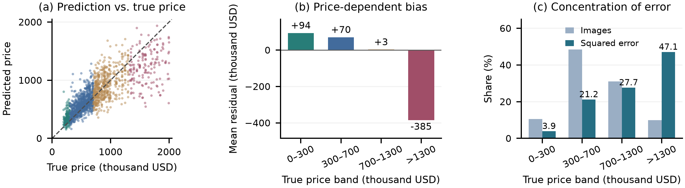
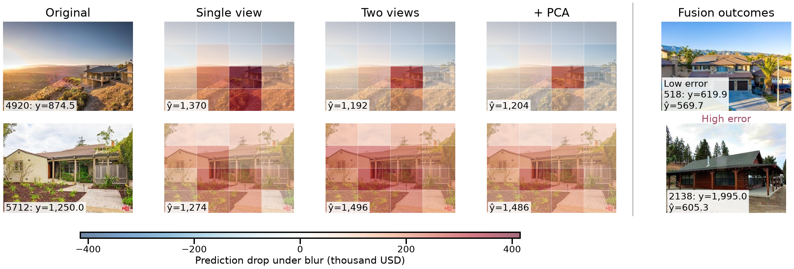

# House Price Prediction with Frozen Visual Features and Kernel Fusion

## Introduction

House prices depend on size, condition, location and market conditions. Exterior photographs reveal architectural form, surface appearance and surrounding scenes, but provide incomplete coverage and omit many valuation factors. We investigate how to extract more informative visual features to predict sale prices more accurately.

Handcrafted descriptors summarize local gradients and textures; AlexNet [1] learns hierarchical features. CLIP [2], SigLIP2 [3] and Perception Encoder [4] enable transfer through frozen visual features and separately fitted regression.

Our three stages test local SIFT appearance, controlled AlexNet training and architecture changes, then frozen pretrained features. Remaining scratch-model error motivates investigating image coverage, feature transformation and regression before combining branches.

The final fusion achieves validation MSE 52,201.21, MAE 159.58 and public Kaggle MSE 47,291.35 after full-data refitting.

## Methods

### Data, Metrics and Evaluation Protocol

The supplied Southern California dataset contains 8,000 labelled training images and 3,000 unlabelled test images; prices are in thousand USD. General-purpose pretrained encoders provide transferable features.

We split the data into 6,399 training and 1,601 validation images with seed 2026, keeping identified duplicate or related-image groups together. For $N$ evaluated images with true prices $y_i$ and predictions $\hat y_i$, we report

$$

\mathrm{MSE}=\frac{1}{N}\sum_{i=1}^{N}(\hat y_i-y_i)^2,\qquad
\mathrm{MAE}=\frac{1}{N}\sum_{i=1}^{N}|\hat y_i-y_i|.

$$

MSE, the primary metric, emphasizes large errors; MAE measures average absolute error. Their units are (thousand USD)$^2$ and thousand USD, respectively. Signed residuals $\hat y_i-y_i$ describe bias.

Stochastic models use seed 2026 screening and promising candidates receive 2027/2028 reruns. Adoption requires lower three-seed mean MSE and two paired wins. Frozen regressors use grouped three-fold training out-of-fold (OOF) selection; codebooks, scalers, PCA and supervised transforms are fold-fitted.

### Baselines and Controlled CNN Development

Beyond a training-mean reference, we extract grayscale SIFT descriptors [5, 6] and build a 256-word visual vocabulary [7]. Histograms undergo L1--square-root--L2 normalization and standardization before Ridge regression [8] ($\alpha=10$). Histogram pooling discards spatial arrangement, motivating learned CNN features.

Our scratch AlexNet regressor [1] uses five convolutional layers, a 9216--4096--4096--1 head, direct $224\times224$ resizing, RGB mean/SD 0.5 and no filtering. The retained configuration uses AdamW [9] ($10^{-4}$ learning rate and weight decay), dropout [10, 11] 0.5, and effective batch 32 through microbatch 4 and eight-step accumulation. Training uses prices divided by 1,000; predictions are restored to dataset units. Runs last at most 60 epochs, with a minimum of 40 and patience 15 under a 0.1% improvement stopping rule; the checkpoint with strictly lowest validation MSE is retained.

Optimization screens use learning rates $3\times10^{-5}$, $10^{-4}$, $3\times10^{-4}$ and $10^{-3}$, effective batches 16/32/64 and dropout 0/0.2/0.5. We compare Adam [12], cosine decay [13] without restarts, effective batch size, regularization and initialization [14, 15], then test augmentation. Geometric and degradation transforms are evaluated separately; horizontal flip uses probability 0.5. Architecture experiments test stacked $3\times3$ convolutions [16] replacing the second $5\times5$ layer, an Inception-style multi-scale block [17], and a projected residual connection [18]. To reduce dense-head capacity, we project the $6\times6$ convolutional grid to 128 channels, add positional information and normalization, and average the 36 tokens before linear regression. We then test a one-layer Transformer [19] with dimension 128, four heads and a 512-dimensional feed-forward layer. Each change is evaluated against its corresponding control.

A separate seed-2026 screen multiplies brightness or contrast by $U(0.9,1.1)$ before resizing and normalization, using a fresh unaugmented control with matched initialization, split and training settings.

### Frozen Representations, Views and Regression

Frozen CLIP ViT-B/32 with standardized Ridge establishes the transfer reference; final branches use SigLIP2 So400m NaFlex, PE-Core-L/14 and PE-Core-G/14. NaFlex preserves native aspect ratio with 576 patches and produces 1,152-dimensional features. Because a single crop can remove useful context, PE-L combines three 1,024-dimensional views: the official input, a 336-pixel gray-padded whole frame, and a central crop spanning 60% of image width and height. PE-G combines its official 448-pixel view with a gray-padded whole frame. Views are unit-normalized, concatenated and renormalized: PE-L has 3,072 dimensions; PE-G has 2,560.

RBF kernel ridge regression [20] models nonlinear feature--price relationships. For unit features, squared distance equals twice one minus cosine similarity; $\gamma$ controls locality. For $x$,

$$

 K_{ij}=\exp(-\gamma\|x_i-x_j\|^2),\quad
 c=(K+\alpha I)^{-1}(y-\bar y\mathbf{1}),

$$

with prediction $\bar y+k(x)^Tc$ and non-negative clipping. Ordinary kernel searches use $\gamma\in\{1,4,16\}$ and $\alpha\in\{0.01,0.1,1,10\}$ on training folds. NaFlex selects $\gamma=1$, $\alpha=0.1$.

PE-L adapts generic similarity using fold-fitted PLS [21, 22]. Of sixteen fitted components, the first four standardized scores $s$ enter the product kernel

$$

 k(x,x')=\exp\left(-\|x-x'\|^2-0.1\frac{\|s-s'\|^2}{4}\right),

$$

with $\alpha=1$. The scores introduce price supervision while the encoder remains frozen.

In contrast to supervised PLS, PCA [23] compresses features along their principal variation directions without using prices. For PE-G, we test 64, 256 and 1,024 dimensions with whitening powers 0 and 0.5, followed by unit normalization. Since this changes distances, we also recalibrate the original $\gamma=4$:

$$

 \gamma'=4\frac{\operatorname{median}\|x_i-x_j\|^2}
 {\operatorname{median}\|z_i-z_j\|^2},

$$

using 8,192 fixed non-self pairs drawn only from fitting-fold images. Here $z$ is the transformed unit vector. The selected transform is non-whitened PCA256 with $\alpha=1$.

### Fusion and Final Refit

Following stacked regression [24], we combine branch predictions using non-negative weights, additionally constrained to sum to one. Weights are fitted to training OOF predictions and evaluated by meta cross-fitting: each fold is predicted using weights fitted on the remaining folds. A new branch is retained when meta-CV MSE improves by at least 1%, at least two of three folds improve, and validation MSE also decreases.

The final weights are NaFlex 0.108065, PE-L PLS 0.080806 and PE-G PCA 0.811129. For the Kaggle submission, we retain the selected hyperparameters and weights and refit the transforms and regression heads on all 8,000 labelled images, recomputing PCA and bandwidth statistics from this training set. The fitted model then predicts the 3,000 test prices.

## Results

| Method | Validation MSE | Validation MAE |
|---|---:|---:|
| Training mean | 151,840 | 294.47 |
| SIFT–BoVW–Ridge | 145,337 | 288.66 |
| AlexNet (no augmentation) | 127,774 | 264.52 |
| AlexNet + horizontal flip | 126,810 | 268.02 |
| Flip AlexNet + mean-pooling head | 122,334 | 261.48 |
| Frozen CLIP B32 + Ridge | 91,821 | 223.27 |
| NaFlex + RBF | 63,086 | 181.28 |
| PE-L, three views + RBF | 59,213 | 172.90 |
| PE-L, three views + PLS/RBF | 59,483 | 171.73 |
| PE-G, two views + PCA/RBF | 52,806 | 160.67 |
| Selected three-encoder fusion | 52,201 | 159.58 |

Table 1. Validation n = 1,601. SIFT and the three AlexNet rows are three-seed means; frozen-feature rows use selected fits. All entries are point estimates.

### Local Evidence and the Need for Learned Representations

SIFT--BoVW--Ridge reduces training-mean MSE 151,839.69 to $145,336.73\pm1,091.58$, revealing limited local-appearance signal. AlexNet improves this to 128,415.68 with padding and 127,774.42 with direct resizing (Table~1), motivating training and capacity experiments.

### Testing Training and Capacity Before Transfer

| Setting | MSE | MAE |
|---|---:|---:|
| **A. Geometric and degradation screen** | | |
| No augmentation | 128,268.67 | 259.99 |
| Horizontal flip | 126,601.97 | 263.16 |
| Rotation | 129,526.18 | 260.29 |
| Translation | 129,162.73 | 262.97 |
| Random crop | 130,222.98 | 272.60 |
| Gaussian blur | 129,941.36 | 261.20 |
| Gaussian noise | 131,174.53 | 271.48 |
| Random erasing | 128,114.40 | 268.07 |
| **B. Photometric screen** | | |
| Fresh control | 131,389.94 | 282.64 |
| Brightness | 131,433.91 | 274.50 |
| Contrast | 128,860.53 | 269.01 |

Seed 2026; validation n=1,601. One augmentation per run; A and B use their respective unaugmented controls.

Seed-matched trials provide little support for optimization changes. Adam at learning rate 0.001 improves seed 2026 but loses the other two comparisons, increasing mean MSE by 509.89; cosine decay, alternative batches and lower dropout also fail adoption. Horizontal flip instead reduces mean MSE by 964.41 with two paired wins, although MAE rises from 264.52 to 268.02. Erasing improves the initial screen (Table~2) but wins only one of three reruns and is rejected.

To test whether the large prediction head limits learning, we replace it with mean pooling. All three seeds improve, reducing MSE by 4,475.78 relative to flip AlexNet. Small-kernel, multi-scale and residual screens fail their controls; the Transformer increases single-seed MSE by 3,615.11 over the compact head. Greater capacity therefore does not resolve this setting's prediction difficulty.

Table~2 compares the single-seed screens. Contrast reduces MSE by 1.93% but increases above-1,300 tail MSE by 17.14%; brightness increases tail MSE by 3.86%. Thus, aggregate improvement can conceal worse high-price predictions.

| Configuration | Validation MSE | Meta MSE |
|---|---:|---:|
| PE-G PCA only | 52,805.77 | 52,531.27 |
| No NaFlex | 52,597.50 | 52,359.30 |
| No PE-L PLS | 52,194.81 | 52,244.24 |
| No PE-G PCA | 57,372.90 | 57,694.20 |
| Equal weights | 53,847.68 | 54,214.33 |
| Full fusion | 52,201.21 | 52,210.22 |

After branch removal, remaining weights are refitted on training OOF predictions only. Validation n=1,601; meta uses three-fold cross-fitting on training OOF predictions.

CLIP with Ridge reaches MSE 91,820.73, motivating richer transferred features. Transferred features may reduce the burden of learning visual structure from limited price labels.

### Recovering Context and Repairing Kernel Geometry

PE-G geometry and regression. (a,b) Empirical CDFs of distances and kernel similarities for 8,192 training pairs; (c) grouped three-fold OOF MSE for non-whitened PCA. Transforms and bandwidths are fitted within each fold. Panel (b) shows the similarity range 0--0.4.

Supplementing PE-G's official view with the whole frame reduces validation MSE from 55,097.49 to 53,252.81 and OOF MSE from 55,679.73 to 53,646.46, supporting broader coverage.

However, compressing these features with PCA256 and fixed $\gamma=4$ worsens OOF MSE to 77,771.43. The training median squared distance changes from 0.5402 to 2.0515, so we recalibrate $\gamma$ to 1.05323 (Fig.~1). OOF MSE falls to 52,531.27; validation MSE reaches 52,805.77 and MAE 160.67. Compression therefore requires a matching downstream similarity scale.

Supervised adaptation is also not uniformly beneficial: PE-L PLS slightly worsens validation MSE relative to its three-view RBF control, while improving MAE.

### Complementarity and Remaining Valuation Ambiguity

Selected fusion on 1,601 validation images. (a) Predicted versus true price; the dashed line is perfect prediction and colors follow the price bands in (b). (b) Mean residual $\hat y-y$. (c) Image and squared-error shares. Bands are $(0,300]$, $(300,700]$, $(700,1300]$ and above 1,300 thousand USD.

Left four columns: PE-G regional sensitivity under $4\times4$ blur replacement; red indicates a prediction decrease, blue an increase, on one shared scale. Cases 4920/5712 are the largest improvement/worsening after adding the whole frame among 1,543 landscape validation images. Right column: separate final-fusion cases, 518 at the 25th absolute-error percentile and retained failure 2138. Prices are in thousand USD.

Adding PE-G PCA lowers meta-CV MSE from 53,052.57 to 52,210.22 with all three folds improving, and validation MSE from 52,524.78 to 52,201.21. Public Kaggle MSE changes from 47,837.69 to 47,291.35.

Table~3 shows a 1.14% gain over PE-G PCA alone; removing PE-G has the largest cost, while equal weighting dilutes its contribution. Removing PE-L slightly improves validation MSE but worsens meta-CV, so its benefit is marginal and criterion-dependent. The small PE-L contribution suggests substantial overlap with the dominant PE-G predictions.

Aggregate success leaves a new problem: mean residual $+6.51$ masks low-price overestimation ($+93.72$ at prices up to 300) and high-price underestimation ($-385.16$ above 1,300). The 159 highest-price images contribute 47.13% of squared error (Fig.~2); the 161 largest errors contribute 63.30%. RMSE is 228.48 and median absolute error 113.41.

### Qualitative Cases and Regional Sensitivity

Figure~3 contrasts fusion case 518 (absolute error 50.17) with severely underestimated case 2138. Similar exterior evidence may correspond to different prices because location and floor area remain hidden. The latter has a true price of 1,995 but a prediction near 605 thousand USD. Its large residual illustrates why the high-price tail dominates MSE even when most predictions lie closer to the diagonal.

The PE-G comparisons expose a second distinction: broader coverage improves the average without benefiting every image. For case 4920, adding the whole frame moves the prediction from about 1,370 to 1,192, toward the true 874.5. For case 5712, the same change moves a near-correct 1,274 estimate to 1,496 against a true 1,250. PCA then changes these estimates only slightly. Thus, the view construction has a larger effect than compression in these two examples.

Regional perturbation [25] tests a narrower question. Replacing $4\times4$ regions with gray pixels or radius-8 blur gives the largest responses near house regions (Fig.~3). However, the two-view gray/blur correlation for 5712 is only 0.267. Gray replacement removes local structure, whereas blur retains coarse appearance; this difference may explain the sensitivity to replacement choice.

## Discussion

The three routes reveal complementary requirements for visual valuation. Handcrafted SIFT features explicitly represent local appearance, but visual-word pooling discards spatial relationships, potentially limiting discrimination between properties with different building and environmental layouts. This highlights the importance of organizing image evidence.

The scratch-CNN route makes this organization learnable, but requires learning features and price relationships from limited supervision. The compact head suggests that matching capacity to available labels can be more useful than architectural complexity. The compact head may reduce fitting of incidental image details. Horizontal flip and contrast also reveal that augmentation must preserve the information needed by the target: reducing sensitivity to image variation can improve one error metric while worsening another. The resulting design choice is to retain changes that improve repeated price-prediction comparisons, rather than accumulate architectural and augmentation operations.

Frozen pretrained encoders supply knowledge learned beyond the price-labelled dataset, allowing task learning to focus on regression. Adaptation remains essential: views determine which evidence survives preprocessing, while transforms and kernel geometry connect visual similarity to price. Caching enables reuse on limited hardware, although dense kernels constrain scalability; fusion exploits complementary representations with unequal contributions. The relatively small gain beyond PE-G PCA makes the strongest individual representation an essential reference. It also suggests that future progress should prioritize resolving shared errors, particularly expensive properties, over adding branches with similar predictions. In deployment, the small fusion gain must be weighed against extracting features from three encoders. A single PE-G branch offers a simpler alternative when computational cost matters; full fusion prioritizes predictive accuracy.

Together, accurate prediction requires informative representations, adequate coverage and a mapping aligned with valuation. Appearance provides partial evidence of value; unobserved location, floor area and transaction conditions may explain remaining ambiguity. Next, we would compare errors by building coverage, occlusion and scene context before testing targeted views. High-price sampling should be checked for error shifts in ordinary-price groups, while contrast augmentation needs multi-seed confirmation. An independent grouped evaluation would measure generalization after the repeated development comparisons and branch selection.
## References

[1] A. Krizhevsky, I. Sutskever, and G. E. Hinton [ImageNet classification with deep convolutional neural networks](https://papers.nips.cc/paper_files/paper/2012/hash/c399862d3b9d6b76c8436e924a68c45b-Abstract.html). Advances in Neural Information Processing Systems, vol. 25, 2012.

[2] A. Radford et al. [Learning transferable visual models from natural language supervision](https://proceedings.mlr.press/v139/radford21a.html). Proc. ICML, 2021, pp. 8748–8763.

[3] M. Tschannen et al. [SigLIP 2: Multilingual vision-language encoders with improved semantic understanding, localization, and dense features](https://arxiv.org/abs/2502.14786). arXiv:2502.14786, 2025.

[4] D. Bolya et al. [Perception Encoder: The best visual embeddings are not at the output of the network](https://arxiv.org/abs/2504.13181). arXiv:2504.13181, 2025.

[5] D. G. Lowe [Object recognition from local scale-invariant features](https://www.cs.ubc.ca/~lowe/papers/iccv99.pdf). Proc. ICCV, 1999, pp. 1150–1157.

[6] D. G. Lowe [Distinctive image features from scale-invariant keypoints](https://www.cs.ubc.ca/~lowe/papers/ijcv04.pdf). International Journal of Computer Vision, vol. 60, 2004, pp. 91–110.

[7] J. Sivic and A. Zisserman [Video Google: A text retrieval approach to object matching in videos](https://www.robots.ox.ac.uk/~vgg/publications/2003/Sivic03/). Proc. ICCV, 2003, pp. 1470–1477.

[8] A. E. Hoerl and R. W. Kennard [Ridge regression: Biased estimation for nonorthogonal problems](https://doi.org/10.1080/00401706.1970.10488634). Technometrics, vol. 12, 1970, pp. 55–67.

[9] I. Loshchilov and F. Hutter [Decoupled weight decay regularization](https://arxiv.org/abs/1711.05101). Proc. ICLR, 2019.

[10] G. E. Hinton et al. [Improving neural networks by preventing co-adaptation of feature detectors](https://arxiv.org/abs/1207.0580). arXiv:1207.0580, 2012.

[11] N. Srivastava et al. [Dropout: A simple way to prevent neural networks from overfitting](https://jmlr.org/papers/v15/srivastava14a.html). Journal of Machine Learning Research, vol. 15, 2014, pp. 1929–1958.

[12] D. P. Kingma and J. Ba [Adam: A method for stochastic optimization](https://arxiv.org/abs/1412.6980). Proc. ICLR, 2015.

[13] I. Loshchilov and F. Hutter [SGDR: Stochastic gradient descent with warm restarts](https://arxiv.org/abs/1608.03983). Proc. ICLR, 2017.

[14] X. Glorot and Y. Bengio [Understanding the difficulty of training deep feedforward neural networks](https://proceedings.mlr.press/v9/glorot10a.html). Proc. AISTATS, 2010, pp. 249–256.

[15] K. He et al. [Delving deep into rectifiers: Surpassing human-level performance on ImageNet classification](https://openaccess.thecvf.com/content_iccv_2015/html/He_Delving_Deep_into_ICCV_2015_paper.html). Proc. ICCV, 2015, pp. 1026–1034.

[16] K. Simonyan and A. Zisserman [Very deep convolutional networks for large-scale image recognition](https://arxiv.org/abs/1409.1556). Proc. ICLR, 2015.

[17] C. Szegedy et al. [Going deeper with convolutions](https://openaccess.thecvf.com/content_cvpr_2015/html/Szegedy_Going_Deeper_With_2015_CVPR_paper.html). Proc. CVPR, 2015, pp. 1–9.

[18] K. He et al. [Deep residual learning for image recognition](https://openaccess.thecvf.com/content_cvpr_2016/html/He_Deep_Residual_Learning_2016_CVPR_paper.html). Proc. CVPR, 2016, pp. 770–778.

[19] A. Vaswani et al. [Attention is all you need](https://papers.nips.cc/paper_files/paper/2017/hash/3f5ee243547dee91fbd053c1c4a845aa-Abstract.html). Advances in Neural Information Processing Systems, vol. 30, 2017.

[20] C. Saunders, A. Gammerman, and V. Vovk [Ridge regression learning algorithm in dual variables](https://eprints.soton.ac.uk/258942/). Proc. ICML, 1998, pp. 515–521.

[21] H. Wold Estimation of principal components and related models by iterative least squares. Multivariate Analysis, P. R. Krishnaiah, Ed. Academic Press, 1966, pp. 391–420.

[22] S. Wold, A. Ruhe, H. Wold, and W. J. Dunn III [The collinearity problem in linear regression. The partial least squares (PLS) approach to generalized inverses](https://doi.org/10.1137/0905052). SIAM Journal on Scientific and Statistical Computing, vol. 5, 1984, pp. 735–743.

[23] K. Pearson [On lines and planes of closest fit to systems of points in space](https://doi.org/10.1080/14786440109462720). Philosophical Magazine, vol. 2, 1901, pp. 559–572.

[24] L. Breiman [Stacked regressions](https://doi.org/10.1007/BF00117832). Machine Learning, vol. 24, 1996, pp. 49–64.

[25] M. D. Zeiler and R. Fergus [Visualizing and understanding convolutional networks](https://arxiv.org/abs/1311.2901). Proc. ECCV, 2014, pp. 818–833.
